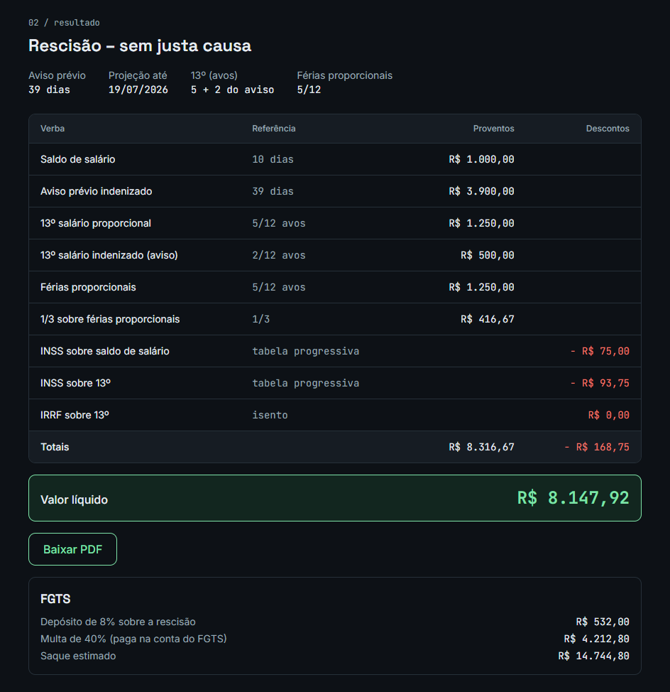
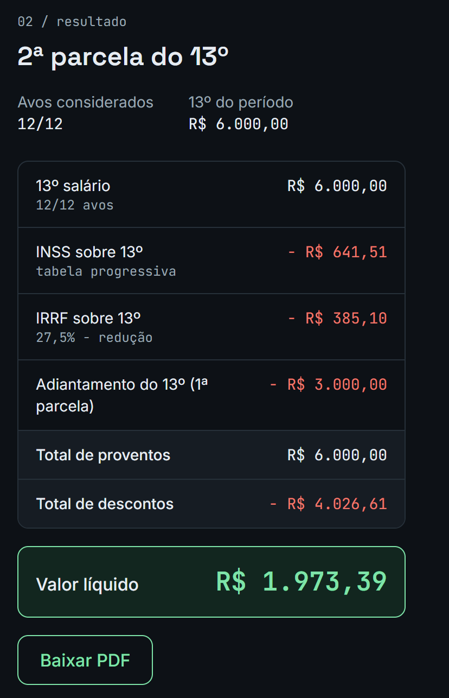
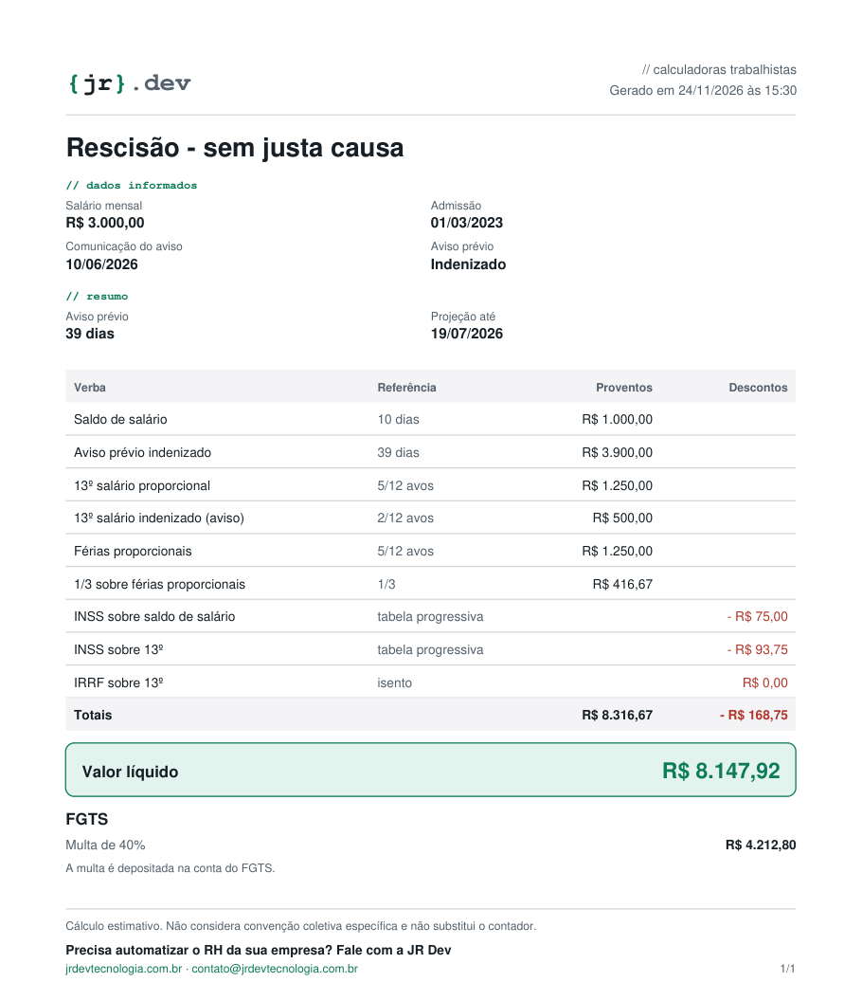

# Calculadoras trabalhistas — JR Dev

Calculadoras gratuitas de **rescisão**, **férias**, **13º salário** e **horas extras**, com o
cálculo linha a linha e download em PDF. Usam as tabelas de INSS e IRRF de 2026, inclusive a
redução do imposto da Lei nº 15.270/2025.

**Site:** https://juanrochaz.github.io/calculadora-trabalhista/

Tudo roda no navegador: não há backend, cadastro nem coleta de dados. O que a pessoa digita
não sai do computador dela.

> **Aviso legal:** cálculo estimativo. Não considera convenção coletiva específica e não
> substitui o contador.


## Calculadoras

| Calculadora                                                                          | O que calcula                                                                                                                                                                                                 |
| ------------------------------------------------------------------------------------ | ------------------------------------------------------------------------------------------------------------------------------------------------------------------------------------------------------------- |
| [Rescisão](https://juanrochaz.github.io/calculadora-trabalhista/rescisao/)           | Sem justa causa, pedido de demissão, acordo (art. 484-A) e justa causa. Saldo de salário, aviso prévio proporcional, 13º, férias vencidas e proporcionais + 1/3, INSS, IRRF e FGTS (depósito, multa e saque). |
| [Férias](https://juanrochaz.github.io/calculadora-trabalhista/ferias/)               | Férias a tirar com 1/3 e abono pecuniário (venda de dias), com INSS e IRRF; férias proporcionais na rescisão. Faltas reduzem os dias (art. 130).                                                              |
| [13º salário](https://juanrochaz.github.io/calculadora-trabalhista/decimo-terceiro/) | 1ª parcela, 2ª parcela com INSS e IRRF, e 13º proporcional no desligamento.                                                                                                                                   |
| [Horas extras](https://juanrochaz.github.io/calculadora-trabalhista/horas-extras/)   | Horas a 50% e 100%, reflexo no DSR e o líquido do mês com INSS e IRRF.                                                                                                                                        |

<table>
  <tr>
    <td width="60%"></td>
    <td width="40%"></td>
  </tr>
  <tr>
    <td>Resultado da rescisão, linha a linha</td>
    <td>13º no celular</td>
  </tr>
</table>

O resultado pode ser baixado em PDF, na versão clara da marca:



<sub>Todos os prints usam valores fictícios.</sub>

## Regras de cálculo

As regras foram validadas por quem faz folha de pagamento no dia a dia. Os valores ficam em
**centavos (inteiros)** dentro das funções e só são arredondados no resultado final de cada
verba.

- **Avos de 13º:** no mês de admissão, conta se a admissão foi até o dia 15. Nos outros meses
  incompletos, conta com 15 dias ou mais trabalhados.
- **Avos de férias:** contados a partir do início do período aquisitivo; a sobra de 15 dias ou
  mais vale 1 avo.
- **Aviso prévio:** 30 dias + 3 por ano completo, até 90. Indenizado, projeta o 13º e as férias.
  No acordo, paga e projeta a metade.
- **INSS:** progressivo por faixas, até o teto.
- **IRRF mensal (salário, férias, horas extras):** usa o maior entre o desconto simplificado e
  as deduções legais, e aplica a redução de 2026.
- **IRRF do 13º:** tributação exclusiva, só com deduções legais e com a redução de 2026.
- **Isentos:** aviso prévio indenizado, férias indenizadas + 1/3, abono pecuniário e o 13º
  projetado pelo aviso.
- **Horas extras:** valor-hora = salário ÷ divisor (jornada semanal × 5, editável). DSR =
  (horas extras ÷ dias úteis) × (domingos + feriados), com sábado como dia útil.
- **FGTS na rescisão:** 8% sobre saldo de salário, aviso indenizado e 13º. Multa de 40% (sem
  justa causa) ou 20% (acordo) sobre o saldo informado + esses depósitos.

Os detalhes de cada regra estão no comentário do topo de cada arquivo em `src/calc/`.

## Como rodar

Requer Node.js 24 ou mais novo.

```bash
npm install
npm run dev           # site em http://localhost:5173
npm test              # testes das regras de cálculo (Vitest)
npm run lint          # ESLint
npm run format:check  # Prettier
npm run build         # build de produção em dist/
```

## Organização

```
src/
├─ calc/                 # regras puras (sem React), cada uma com testes
│  ├─ rescisao.ts  ferias.ts  decimo.ts  horaExtra.ts
│  ├─ descontos.ts       # INSS e IRRF
│  ├─ resultado.ts       # formato das linhas do resultado
│  └─ util.ts            # datas, avos, arredondamento
├─ config/
│  ├─ tabelas-2026.ts    # INSS, IRRF, dependente, simplificado, redução, salário mínimo
│  └─ tabelas.ts         # qual tabela está em uso
├─ pages/                # uma página por calculadora
├─ components/           # formulário, resultado, botão de PDF, aviso legal, CTA
├─ pdf/                  # geração do PDF (jsPDF, carregado só no clique)
└─ seo/paginas.json      # título e descrição de cada página
scripts/gerar-paginas.mjs  # HTML por rota com SEO, sitemap.xml, robots.txt e 404.html
```

## Como atualizar as tabelas

1. Copie `src/config/tabelas-2026.ts` para `tabelas-AAAA.ts` e preencha com os valores
   oficiais (gov.br e Receita Federal), anotando a fonte e a data no comentário do topo.
2. Troque o export em `src/config/tabelas.ts`.
3. Rode `npm test`. O teste `tabelas-2026.test.ts` confere a coerência das faixas (sem saltos
   entre faixas do IRRF, INSS progressivo igual à tabela com parcela a deduzir); copie e
   ajuste para o novo ano.

As funções de cálculo não mudam. Os testes das regras usam tabelas fictícias ou as oficiais
com salários fictícios.

## SEO e deploy

- Cada página tem título e descrição em `src/seo/paginas.json`.
- No build, `scripts/gerar-paginas.mjs` grava um HTML por rota com título, descrição,
  canonical, Open Graph e dados estruturados (JSON-LD), além de `sitemap.xml`, `robots.txt` e
  `404.html`. Assim buscadores e redes sociais leem as tags sem rodar o JavaScript.
- A cada push na `main`, o GitHub Actions roda lint, formatação, testes e build, e publica no
  GitHub Pages. O endereço vem das variáveis `SITE_URL` e `BASE_PATH` no workflow.

## Privacidade

- Nenhum dado é enviado: não há backend, analytics nem cookies.
- As fontes são servidas pelo próprio site (sem Google Fonts).
- Os testes e os prints usam apenas nomes e valores fictícios.

---

Feito pela [JR Dev](https://jrdevtecnologia.com.br) · da planilha ao código.
Precisa automatizar o RH da sua empresa? [Fale com a JR Dev](mailto:contato@jrdevtecnologia.com.br).
